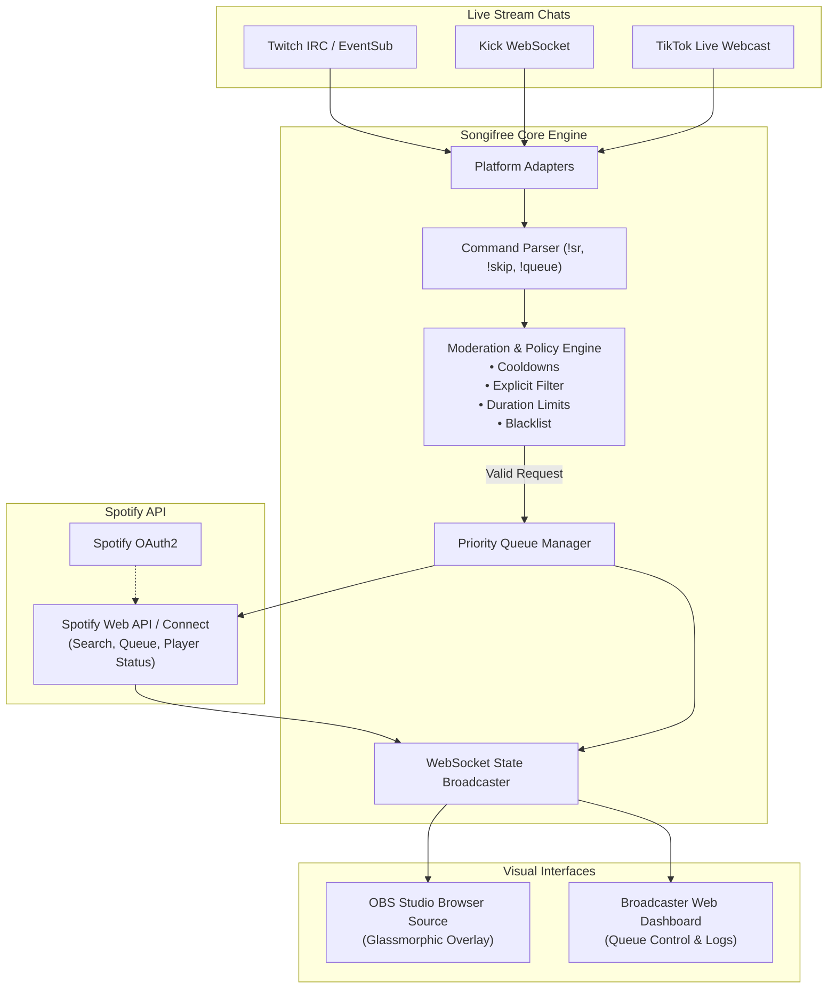

<div align="center">

# 🎵 Songifree

**Cross-platform live stream music request bot & real-time OBS overlay bridging Spotify with Twitch, Kick, and TikTok live chats.**

[](LICENSE)
[](#-supported-streaming-platforms)
[](CONTRIBUTING.md)
[](https://github.com/AndorinaAI/songifree/tree/dev)

[Explore Features](#-features) •
[Quick Start](#-quick-start) •
[Chat Commands](#-chat-commands) •
[OBS Overlay](#-obs-overlay-widget) •
[Architecture](#-architecture) •
[Contributing](CONTRIBUTING.md) •
[Discussions](https://github.com/AndorinaAI/songifree/discussions)

</div>

---

## 📖 Overview

**Songifree** empowers live streamers to turn music into an interactive community experience. Instead of running three different bots or clunky workarounds, Songifree unifies chat song requests across **Twitch**, **Kick**, and **TikTok Live** directly into your **Spotify** playback queue.

It includes an automated queue moderation engine (explicit filters, cooldowns, duration caps, vote-to-skip), an ultra-slick **OBS Studio Browser Source overlay** with animated album art & waveforms, and a local **Broadcaster Web Dashboard** for real-time control.

---

## ✨ Features

- 🎧 **Deep Spotify Connect Integration**:
  - Direct playback sync, track search, automatic queue insertion, pause/resume, and volume normalization.
  - Automatically fetches track metadata, high-res album covers, and duration.
- 💬 **Multi-Platform Chat Ingestion**:
  - **Twitch**: IRC & EventSub listener with badges (Broadcaster, Mod, VIP, Sub, Viewer).
  - **Kick**: Real-time Pusher / WebSocket connection for channel chat.
  - **TikTok Live**: Webcast event protocol parsing chat messages & gifts in real time.
- 🛡️ **Broadcaster-First Moderation & Anti-Abuse**:
  - **Cooldowns**: Configurable delay per user to prevent chat spam.
  - **Explicit Filter**: Automatic rejection of Spotify tracks with explicit tags.
  - **Duration Limit**: Prevent trolls from queueing 10-hour loops.
  - **Queue Limits**: Maximum queue capacity and duplicate prevention.
  - **Blacklist / Whitelist**: Instant banning of specific artists, track IDs, or keywords.
  - **Vote to Skip**: Community-driven skipping with configurable vote thresholds.
  - **Role Privileges**: Grant bypasses to Moderators, VIPs, or Subscribers.
- 🎨 **Modern OBS Browser Source Overlay**:
  - Plug-and-play browser source (`http://localhost:3000/overlay`).
  - Dark glassmorphic aesthetic, animated vinyl record spinning, audio equalizer bars, requester platform badge (Twitch / Kick / TikTok), and live progress bar.
- 🎛️ **Broadcaster Web Dashboard**:
  - Local control panel (`http://localhost:3000`) with live playback progress, queue reordering/deletion, manual track addition, chat log monitor, and one-click skip/pause/volume.

---

## 🏛️ Architecture



---

## 🕹️ Supported Streaming Platforms

| Platform | Protocol | Chat Commands | Requester Badges | Status |
| :--- | :--- | :---: | :---: | :---: |
| **Twitch** | WebSocket / IRC (`tmi.js`) | :white_check_mark: | Broadcaster, Mod, VIP, Sub | Supported |
| **Kick** | Pusher / WebSockets | :white_check_mark: | Broadcaster, Mod, Sub, Viewer | Supported |
| **TikTok Live** | TikTok Webcast Protocol | :white_check_mark: | Follower, Subscriber, Viewer | Supported |
| **YouTube Live** | YouTube Data API v3 | *Planned* | Moderator, Member | *Roadmap* |

---

## 💬 Chat Commands

Viewers and moderators can interact with Songifree using the following chat commands:

| Command | Arguments | Permissions | Description |
| :--- | :--- | :--- | :--- |
| `!sr` / `!songrequest` | `<query or Spotify URL>` | Everyone | Request a song to be queued on Spotify. |
| `!song` / `!np` | *none* | Everyone | Displays the currently playing track and artist. |
| `!queue` | *none* | Everyone | Shows the next upcoming tracks in queue. |
| `!voteskip` | *none* | Everyone | Cast a vote to skip the current track. |
| `!skip` | *none* | Mod / Broadcaster | Immediately skips the currently playing song. |
| `!volume` | `<0-100>` | Mod / Broadcaster | Sets Spotify playback volume. |
| `!pause` / `!resume` | *none* | Mod / Broadcaster | Pauses or resumes Spotify playback. |
| `!blacklist` | `add <term> \| remove <term>` | Broadcaster | Adds or removes an artist/song from the blacklist. |
| `!clearqueue` | *none* | Broadcaster | Clears all pending songs from the queue. |

---

## 🚀 Quick Start

### 1. Prerequisites
- **Node.js 18+** or **20 LTS** installed on your system.
- A **Spotify Premium** account (required by Spotify Web API for playback control).
- Spotify running on your PC or speaker (Spotify Connect active).

### 2. Clone and Install
```bash
git clone https://github.com/AndorinaAI/songifree.git
cd songifree
npm install
```

### 3. Setup Spotify Developer App
1. Go to the [Spotify Developer Dashboard](https://developer.spotify.com/dashboard) and log in.
2. Click **Create app**:
   - **App name**: `Songifree`
   - **Redirect URI**: `http://localhost:3000/api/spotify/callback`
   - **APIs used**: Web API & Web Playback SDK
3. Copy your **Client ID** and **Client Secret**.

### 4. Configure Environment
```bash
cp .env.example .env
```
Edit `.env` and fill in your credentials:
```env
PORT=3000
SPOTIFY_CLIENT_ID=your_client_id_here
SPOTIFY_CLIENT_SECRET=your_client_secret_here

# Enable your stream platforms
TWITCH_ENABLED=true
TWITCH_CHANNEL=your_channel_name
TWITCH_OAUTH_TOKEN=oauth:your_oauth_token

KICK_ENABLED=true
KICK_CHANNEL_SLUG=your_channel_slug

TIKTOK_ENABLED=true
TIKTOK_USERNAME=your_username
```

### 5. Run Songifree
```bash
# Start in development mode
npm run dev

# Or build and run production mode
npm run build
npm start
```
1. Open `http://localhost:3000` in your browser.
2. Click **Connect Spotify** to complete the one-time OAuth authentication.
3. Start streaming and let your chat request songs!

---

## 🎨 OBS Overlay Widget

Songifree includes an OBS Browser Source overlay designed for live streams:

1. In **OBS Studio**, navigate to your active Scene.
2. Click `+` under **Sources** and select **Browser**.
3. Configure the source:
   - **URL**: `http://localhost:3000/overlay`
   - **Width**: `650`
   - **Height**: `180`
   - Check **Shutdown source when not visible**.
   - Check **Refresh browser when scene becomes active**.
4. Position the overlay on your stream canvas. You now have an animated now-playing card with real-time album artwork, progress bar, and requester platform indicators!

---

## 🌿 Branching & Development Workflow

We follow standard GitFlow:
- **`main`**: Protected branch containing stable, release-ready code.
- **`dev`**: The active integration branch. **All Pull Requests and feature branches must target `dev`**.

```bash
# Checkout the dev branch for development
git checkout dev
git checkout -b feature/my-new-feature
```

Check out our [Contributing Guide](CONTRIBUTING.md) for full instructions on code style, commit standards, and PR requirements.

---

## 🗺️ Roadmap

- [x] Initial repository structure and CI setup.
- [x] Spotify Web API authentication & playback queue engine.
- [x] Twitch IRC chat listener.
- [x] Kick WebSocket chat listener.
- [x] TikTok Live Webcast chat listener.
- [x] Dynamic OBS Browser Source overlay.
- [x] Broadcaster Web Dashboard with queue manager.
- [ ] YouTube Live chat adapter.
- [ ] Soundcloud / YouTube Music provider support.
- [ ] Elgato Stream Deck plugin / Webhook integration.
- [ ] Native Desktop App packaging (Electron / Tauri).

---

## 🤝 Community & Support

- **Discussions**: Have questions, ideas, or want to share your stream layout? Join [GitHub Discussions](https://github.com/AndorinaAI/songifree/discussions).
- **Issues**: Found a bug or need a feature? Open an issue using our [templates](https://github.com/AndorinaAI/songifree/issues/new/choose).
- **Security**: Report vulnerabilities responsibly via [SECURITY.md](SECURITY.md).

---

## 📄 License

Songifree is distributed under the [MIT License](LICENSE).
Built with ❤️ by [AndorinaAI](https://github.com/AndorinaAI) and contributors.
